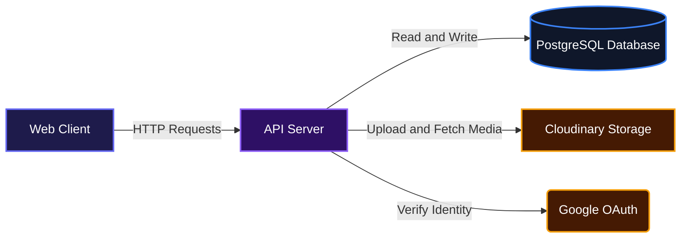
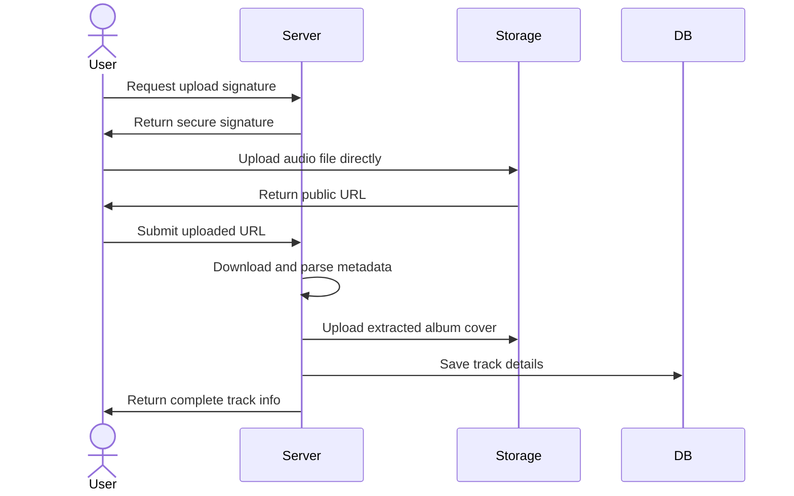
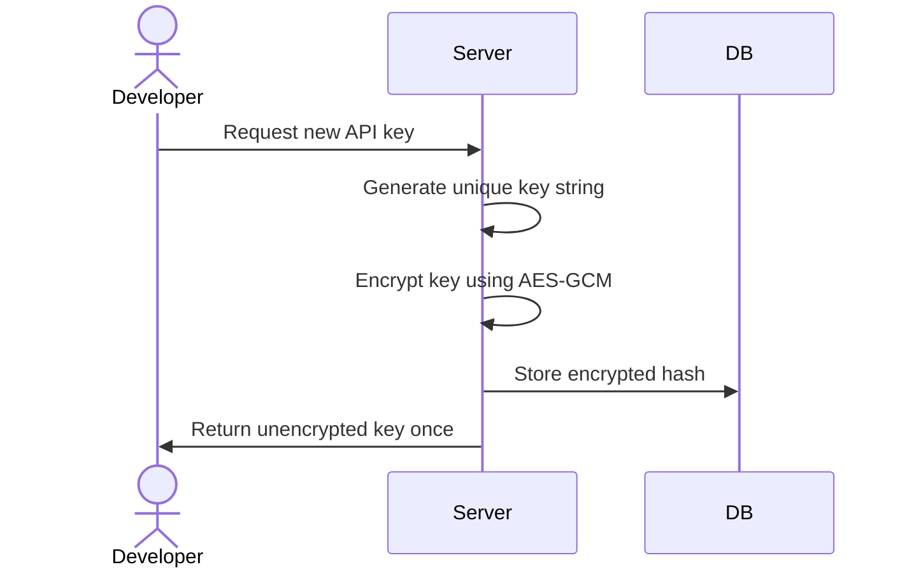

# Melodia

Melodia helps teams manage, stream, and share music libraries securely. It processes audio file uploads, automatically extracts track metadata like album art and duration, and provides a secure API for programmable access. Developers can focus on building their user interface while this backend handles the complexities of audio storage, streaming, and user authentication.

## System Architecture



## Installation

Clone the repository to your local machine:

```bash
git clone https://github.com/skido600/melodai_with_hono.git
```

Navigate to the project directory and install the workspace dependencies using pnpm:

```bash
cd melodai_with_hono
pnpm install
```

Set up your environment variables by copying the example or creating a `.env` file in the `apps/api` directory. 

## Usage

Start the development server from the root directory using Turborepo:

```bash
pnpm run dev
```

The server will start running locally. By default, the API will be available at `http://localhost:3000`. You can test the basic health check endpoint to verify the server is running properly.

```bash
curl http://localhost:3000/health
```

## Features

* **Automated Audio Processing**: Accepts secure audio uploads and automatically parses embedded file metadata to extract details like track names, artists, durations, and album artwork.
* **Developer API Keys**: Provides an administrative endpoint for users to generate and manage encrypted API keys for programmatic access to the music library.
* **Secure Authentication**: Handles user registration and login exclusively via Google OAuth, issuing HTTP-only cookies equipped with rotating JWT access and refresh tokens.
* **Music Streaming Analytics**: Tracks engagement by keeping a running tally of play counts every time a song is streamed or requested by a user.

### Music Upload and Processing Flow



### Secure API Key Generation



## Technologies Used

| Category | Technologies |
| :--- | :--- |
| **Backend Framework** | [](https://hono.dev/) [](https://nodejs.org/) |
| **Language** | [](https://www.typescriptlang.org/) |
| **Database & ORM** | [](https://www.postgresql.org/) [](https://orm.drizzle.team/) |
| **Monorepo Tooling** | [](https://turbo.build/) [](https://pnpm.io/) |

## Environment Variables

Create a `.env` file in the `apps/api` directory with the following variables:

```env
GOOGLE_CLIENT_ID="your_google_client_id"
GOOGLE_CLIENT_SECRET="your_google_client_secret"
NODE_ENV="development"
VERCEL_ENV="development"
JWT_ACCESS_SECRET="your_access_secret"
JWT_REFRESH_SECRET="your_refresh_secret"
DATABASE_URL="your_neon_postgres_url"
FRONTEND_URL="http://localhost:4000"
BACKEND_URL="http://localhost:3000"
CLOUDINARY_CLOUD_NAME="your_cloudinary_name"
CLOUDINARY_API_KEY="your_cloudinary_key"
CLOUDINARY_API_SECRET="your_cloudinary_secret"
COOKIE_SECRET="your_cookie_signing_secret"
API_KEY_SECRET="your_api_key_secret"
API_KEY_ENC_SECRET="must_be_exactly_64_hex_characters"
```

## API Documentation

### System Endpoints

#### GET /health
**Description**: Verifies the server is running.

**Response**:
```json
{
  "success": true,
  "message": "server is active 😍"
}
```

### Authentication Endpoints

#### POST /auth/google/url
**Description**: Generates the Google OAuth redirect URL.

**Request**:
```json
{
  "redirectTo": "/dashboard"
}
```

**Response**:
```json
{
  "success": true,
  "url": "https://accounts.google.com/o/oauth2/v2/auth..."
}
```

#### GET /auth/google/callback
**Description**: Handles the Google OAuth callback, registers the user if necessary, and sets HTTP-only authentication cookies. Redirects to the frontend application on success.

**Errors**:
* 400: Missing google authorization code or invalid data.
* 500: Authentication process failed.

#### GET /auth/me
**Description**: Retrieves the currently authenticated user profile. Requires valid session cookies.

**Response**:
```json
{
  "success": true,
  "message": "User fetched successfully",
  "data": {
    "id": "uuid",
    "name": "Jane Doe",
    "email": "jane@example.com",
    "avatarUrl": "https://example.com/avatar.jpg",
    "createdAt": "2023-10-01T12:00:00Z"
  }
}
```

**Errors**:
* 401: Unauthorized.
* 404: User not found.

#### POST /auth/logout
**Description**: Clears authentication cookies and invalidates the database session. Requires valid session cookies.

**Response**:
```json
{
  "success": true,
  "message": "Logged out successfully",
  "data": null
}
```

### Music Management Endpoints

#### GET /music/v1/upload-signature
**Description**: Retrieves a signed Cloudinary request required for secure file uploading. Requires valid session cookies.

**Response**:
```json
{
  "success": true,
  "data": {
    "signature": "generated_signature",
    "timestamp": 1696150000,
    "folder": "melodia/music",
    "apiKey": "cloudinary_api_key",
    "cloudName": "cloudinary_cloud_name"
  }
}
```

#### POST /music/v1/complete
**Description**: Completes the upload flow by downloading the file from Cloudinary, extracting ID3 audio metadata, uploading the cover art, and saving everything to the database. Requires valid session cookies.

**Request**:
```json
{
  "secureUrl": "https://res.cloudinary.com/...",
  "publicId": "melodia/music/track_id",
  "fileName": "song.mp3",
  "fileSize": 5000000,
  "mimeType": "audio/mpeg"
}
```

**Response**:
```json
{
  "success": true,
  "message": "Music uploaded successfully",
  "data": {
    "id": "uuid",
    "title": "Song Title",
    "artist": "Artist Name",
    "audioUrl": "https://..."
  }
}
```

#### GET /music/v1/all
**Description**: Retrieves a list of all uploaded music. Accepts an optional `q` query parameter for searching by title or artist. Requires valid session cookies.

**Response**:
```json
{
  "success": true,
  "data": [
    {
      "id": "uuid",
      "title": "Song Name",
      "playCount": 0
    }
  ]
}
```

#### GET /music/v1/my
**Description**: Retrieves music uploaded strictly by the authenticated user. Accepts an optional `q` query parameter. Requires valid session cookies.

**Response**:
```json
{
  "success": true,
  "data": []
}
```

#### GET /music/v1/recent
**Description**: Retrieves the 10 most recently uploaded music tracks across the platform. Requires valid session cookies.

**Response**:
```json
{
  "success": true,
  "data": []
}
```

#### POST /music/v1/:id/play
**Description**: Increments the play count for a specific track by its ID. Requires valid session cookies.

**Response**:
```json
{
  "success": true,
  "data": {
    "id": "uuid",
    "playCount": 5
  }
}
```

**Errors**:
* 400: Song ID is required.
* 404: Song not found.

#### GET /music/v1/top
**Description**: Retrieves the top 6 most played tracks that have a play count greater than four. Requires valid session cookies.

**Response**:
```json
{
  "success": true,
  "data": []
}
```

#### DELETE /music/v1/:id
**Description**: Deletes a specific music track. Users can only delete their own uploads. Requires valid session cookies.

**Response**:
```json
{
  "success": true,
  "message": "Music deleted successfully",
  "data": {
    "id": "uuid",
    "title": "Deleted Track Name"
  }
}
```

### Developer API Endpoints

#### POST /api/v1/api-key
**Description**: Generates a new encrypted API key for programmatic access. Requires valid session cookies.

**Request**:
```json
{
  "name": "Production Key"
}
```

**Response**:
```json
{
  "success": true,
  "message": "API key generated successfully",
  "data": {
    "id": "uuid",
    "name": "Production Key",
    "apiKey": "melodia_randomstring12345",
    "createdAt": "2023-10-01T12:00:00Z"
  }
}
```

#### GET /api/v1/key
**Description**: Retrieves a list of all API keys owned by the authenticated user. Requires valid session cookies.

**Response**:
```json
{
  "success": true,
  "message": "API keys fetched successfully",
  "data": [
    {
      "id": "uuid",
      "name": "Development Key",
      "apiKey": "melodia_randomstring12345",
      "active": true
    }
  ]
}
```

#### DELETE /api/v1/key/:id
**Description**: Revokes and deletes a specific API key. Requires valid session cookies.

**Response**:
```json
{
  "success": true,
  "message": "API key deleted successfully",
  "data": {
    "id": "uuid"
  }
}
```

#### GET /api/v1/music
**Description**: Retrieves a developer-friendly list of the top 20 latest tracks. Requires passing a valid API key via the `x-api-key` header or a standard Bearer token.

**Request Headers**:
```json
{
  "x-api-key": "melodia_randomstring12345"
}
```

**Response**:
```json
{
  "success": true,
  "message": "Music fetched successfully",
  "count": 20,
  "data": [
    {
      "id": 1,
      "title": "Track Title",
      "artist": "Artist",
      "audioUrl": "https://..."
    }
  ]
}
```

**Errors**:
* 401: Missing or invalid API key.

## Contributing

We welcome community contributions. To contribute, fork the repository, make your requested changes, and submit a pull request for review. Ensure your code passes all linting and type-checking scripts before submission.

## Author Info

* [GitHub (skido600)](https://github.com/skido600)

<br/>

[](https://dokugen.samueltuoyo.com)